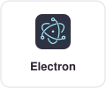
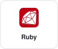
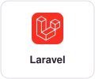
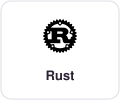
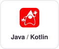
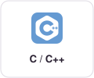
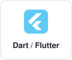
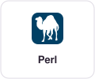
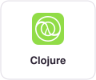
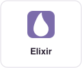

# README SDK grid experiments

Scratch branch for trying platformicons in the `getsentry/sentry` README. Not for merge.

## 1. Inline icons (no CSS, wraps naturally)

<!-- Inline images wrap like flex-wrap. Zero CSS, works everywhere GitHub renders markdown. -->

  
  
  
  
  
  
  
  
  
  
  
  
  
  
  
  
  
  
  
  
  

## 2. HTML table

<!-- Classic table grid. Fixed columns (no wrapping on narrow screens), but labels + links per cell. -->
<table align="center">
  <tr>
    <td align="center" width="110"><a href="https://github.com/getsentry/sentry-javascript"> <b>JavaScript</b></a></td>
    <td align="center" width="110"><a href="https://github.com/getsentry/sentry-electron"> <b>Electron</b></a></td>
    <td align="center" width="110"><a href="https://github.com/getsentry/sentry-react-native"> <b>React Native</b></a></td>
    <td align="center" width="110"><a href="https://github.com/getsentry/sentry-python"> <b>Python</b></a></td>
    <td align="center" width="110"><a href="https://github.com/getsentry/sentry-ruby"> <b>Ruby</b></a></td>
    <td align="center" width="110"><a href="https://github.com/getsentry/sentry-php"> <b>PHP</b></a></td>
    <td align="center" width="110"><a href="https://github.com/getsentry/sentry-laravel"> <b>Laravel</b></a></td>
  </tr>
  <tr>
    <td align="center" width="110"><a href="https://github.com/getsentry/sentry-go"> <b>Go</b></a></td>
    <td align="center" width="110"><a href="https://github.com/getsentry/sentry-rust"> <b>Rust</b></a></td>
    <td align="center" width="110"><a href="https://github.com/getsentry/sentry-java"> <b>Java / Kotlin</b></a></td>
    <td align="center" width="110"><a href="https://github.com/getsentry/sentry-cocoa"> <b>Apple</b></a></td>
    <td align="center" width="110"><a href="https://github.com/getsentry/sentry-dotnet"> <b>.NET</b></a></td>
    <td align="center" width="110"><a href="https://github.com/getsentry/sentry-native"> <b>C / C++</b></a></td>
    <td align="center" width="110"><a href="https://github.com/getsentry/sentry-dart"> <b>Dart / Flutter</b></a></td>
  </tr>
  <tr>
    <td align="center" width="110"><a href="https://github.com/getsentry/perl-raven"> <b>Perl</b></a></td>
    <td align="center" width="110"><a href="https://github.com/getsentry/sentry-clj"> <b>Clojure</b></a></td>
    <td align="center" width="110"><a href="https://github.com/getsentry/sentry-elixir"> <b>Elixir</b></a></td>
    <td align="center" width="110"><a href="https://github.com/getsentry/sentry-unity"> <b>Unity</b></a></td>
    <td align="center" width="110"><a href="https://github.com/getsentry/sentry-unreal"> <b>Unreal</b></a></td>
    <td align="center" width="110"><a href="https://github.com/getsentry/sentry-godot"> <b>Godot</b></a></td>
    <td align="center" width="110"><a href="https://github.com/getsentry/sentry-powershell"> <b>PowerShell</b></a></td>
  </tr>
</table>

## 3. Per-SDK SVG cards with dark-mode CSS inside

<!-- One SVG per SDK, committed to .github/sdk-tiles/. Each SVG carries its own <style>:
     prefers-color-scheme swaps the card colors.
     Still wraps like flex-wrap because they're inline s, and every tile is a real link. -->

  
  
  
  
  
  
  
  
  
  
  
  
  
  
  
  
  
  
  
  
  

## 4. One SVG, foreignObject + CSS flexbox (no per-SDK links)

<!-- One SVG. Inside it: <foreignObject> -> HTML -> real CSS flexbox, custom properties,
     prefers-color-scheme. GitHub can't strip it because it's "just an image".
     Catches: it's an , so no per-SDK links (use an image map? GitHub strips those),
     no text selection, and the layout is fixed-size (scales, doesn't reflow). -->

  

