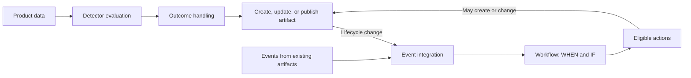

# Workflow Engine

Workflow Engine is Sentry's shared backend for **evaluating data and automating responses
to events**. Detectors produce outcomes; workflows respond to events and take actions.
What gets produced and what happens next are separate, product-specific decisions.

## Why Use It?

A product needs to decide what its data means, what to produce from that evaluation,
and how to respond when something happens. Combining those decisions in one integration
couples detection to downstream behavior and duplicates infrastructure.

Workflow Engine separates them. Product code supplies evaluation logic, outcome
handling, event integration, and action behavior. The shared engine provides configured
conditions, detector state transitions, workflow selection, action filtering, repeat
suppression, and asynchronous dispatch. Changing the response should not require
rewriting detection or changing the artifact being produced.

For example, an issue regressing or an investigation finishing is an **event**. Sending
a Slack message or starting an investigation is an **action**. A workflow expresses the
policy connecting an event to actions; it is not limited to notification delivery.
Several detectors can connect to the same workflow, and a detector can connect to
several workflows.

## The Mental Model

- **Detector:** what does this input mean? Evaluate product data and produce an
  evaluation for outcome handling. Not every evaluation needs to produce anything.
- **Outcome:** what should the evaluation produce? An outcome handler decides how to
  handle it, such as creating or updating a product artifact. Outcome dispatch is
  separate from the detector's evaluation logic.
- **Artifact:** what was produced or changed? A domain result, such as an issue, metric,
  or investigation. This is a conceptual term, not a shared `Artifact` model or a list
  of payload types already supported by every handler.
- **Event:** what happened? A lifecycle change, such as an issue being created or
  regressing, or an investigation starting or finishing. An artifact is not itself an
  event; its owning integration must expose the events a workflow can consume.
- **Workflow:** when should we react to an event? Its **WHEN** conditions determine
  whether it triggers. Each **IF** condition group filters which actions become eligible.
- **Condition:** a reusable check, grouped with other checks. Detector conditions
  evaluate product data; workflow conditions evaluate event input. They share
  evaluation machinery, not interchangeable inputs.
- **Action:** what should happen next? A registered handler performs a side effect.
  It can notify someone or create or change another artifact, which can have its own
  lifecycle events. Passing conditions makes an action eligible; execution controls
  still apply before dispatch.

This is the conceptual model, not a direct call chain or an automatic subscription to
every artifact. Outcome handling, event ingress, and action execution are distinct
integration boundaries. A workflow can respond to an existing artifact's events without
a new detector run.

## Current Implementation and Examples

The task guides document the concrete APIs in this checkout. The registered
[`DetectorOutcome`](handlers/detector_outcome/supported_outcomes.py) currently provides
`ISSUE_PLATFORM`; [`DetectorResult` and `WorkflowEventData`](types.py) still use
issue-specific payloads and context. The default outcome publishes occurrences or
status changes to Issue Platform. Issue events and supported activities, including
Seer stage changes, later enter workflow processing; `process_detectors` does **not**
call `process_workflows` directly.

Issue Platform is one outcome integration, not the definition of the engine. Other
artifact types need corresponding outcome/result support and event ingress; registering
an outcome alone does not make arbitrary payloads consumable by workflows. The guides'
issue-based examples describe those current contracts, not a requirement that every
product model its output as an issue.

## Choose Your Path

| Your Goal                                                                                  | Start Here                                       |
| ------------------------------------------------------------------------------------------ | ------------------------------------------------ |
| Implement a detector or workflow; understand what to build and what to reuse               | [Implementer Guide](docs/implementers/README.md) |
| Maintain the engine; understand how models, processors, tasks, state, and caches cooperate | [Maintainer Guide](docs/maintainers/README.md)   |

Implementers do not need to read the maintainer reference first. The task guides link
to the exact contracts needed along the way.

## Scope and Boundaries

- This is event-driven automation, not an ordered, multi-step job orchestrator.
  Actions run asynchronously with no user-defined execution order.
- A workflow is not necessarily a user-facing alert. Workflow types distinguish alerts
  from hidden automation; visibility does not determine whether a connected workflow runs.
- Workflow Engine detectors are distinct from performance detectors in
  [`sentry.issue_detection`](../issue_detection/README.md), which use a separate runtime.
  Some detector records associate existing issues with workflows rather than run a new
  Workflow Engine detection pipeline.
- New integrations use native detector and workflow APIs. Remaining legacy ID and model
  compatibility is a [maintainer concern](docs/maintainers/legacy-compatibility.md), not
  an implementation prerequisite.

The implementation and tests are authoritative when they differ from these docs.
