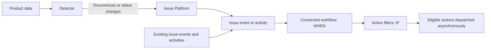

# Workflow Engine

Workflow Engine is Sentry's shared backend for **detecting problems and deciding what
to do about them**. It separates product-specific detection from reusable automation:
a detector decides whether data represents a problem; a workflow decides which issue
events should cause notifications or other actions.

## Why Use It?

A product that detects a problem needs more than a threshold check. It needs to
represent the finding as an issue, handle updates or recovery, and let users decide
when and where to act. Implementing all of that separately for each product couples
detection to notification policy and duplicates infrastructure.

Workflow Engine provides a common configuration model and execution paths for those
concerns. Product code supplies the meaning of its data and the issue it produces.
The shared engine evaluates configured conditions, supports detector state transitions,
selects connected workflows, and applies action filtering, repeat suppression, and
asynchronous dispatch. Issue Platform owns issue ingestion and grouping.

For example, an uptime detector can identify that a check has failed and later
recovered. A connected workflow can notify issue owners about the resulting issue.
Changing who is notified should not require changing how uptime failures are detected.
Several detectors can connect to the same workflow, and a detector can connect to
several workflows.

## The Mental Model

- **Detector:** what counts as a problem? A configured detector selects a
  product-specific implementation. It can produce an issue occurrence or a status
  change. An occurrence describes a finding for Issue Platform to ingest.
- **Workflow:** when should we react to an issue event or activity? Its **WHEN**
  conditions determine whether the workflow triggers. Each **IF** condition group
  filters which attached actions become eligible.
- **Condition:** a reusable check, grouped with other checks. Detector conditions
  evaluate product data; workflow conditions evaluate issue events or activities.
  They share evaluation machinery, not interchangeable inputs.
- **Action:** what should happen? A registered handler performs a side effect, such
  as sending a notification. Passing conditions makes an action eligible; repeat
  suppression, active status, and deduplication still apply before dispatch.

Detection and workflow processing are separate pipelines. In the default outcome path
shown above, detector output goes through Issue Platform; `process_detectors` does **not**
call `process_workflows` directly. Existing issues can enter workflow processing without
a new detector handler.

## Choose Your Path

| Your Goal                                                                                  | Start Here                                       |
| ------------------------------------------------------------------------------------------ | ------------------------------------------------ |
| Implement a detector or workflow; understand what to build and what to reuse               | [Implementer Guide](docs/implementers/README.md) |
| Maintain the engine; understand how models, processors, tasks, state, and caches cooperate | [Maintainer Guide](docs/maintainers/README.md)   |

Implementers do not need to read the maintainer reference first. The task guides link
to the exact contracts needed along the way.

## Scope and Boundaries

- This is issue-driven detection and automation, not a general-purpose job scheduler
  or an ordered, multi-step orchestration system. Actions run asynchronously with no
  user-defined execution order.
- A workflow is not necessarily a user-facing alert. Workflow types distinguish alerts
  from hidden automation; visibility does not determine whether a connected workflow runs.
- Workflow Engine detectors are distinct from performance detectors in
  [`sentry.issue_detection`](../issue_detection/README.md), which use a separate runtime.
  Some detector records associate existing issues with workflows rather than run a new
  Workflow Engine detection pipeline.
- New integrations use native detector and workflow APIs. Remaining legacy ID and model
  compatibility is a [maintainer concern](docs/maintainers/legacy-compatibility.md), not
  an implementation prerequisite.

The implementation and tests are authoritative when they differ from these docs.
