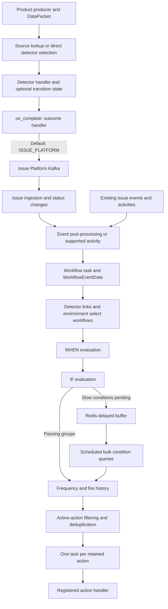

# Maintaining Workflow Engine

Use this guide to navigate the configured graph, runtime boundaries, and operational
state. The [Workflow Engine overview](../../README.md) defines the outcome/artifact/event
model. The architecture tour below traces its current Issue Platform integration;
issue-specific payloads and storage here are implementation contracts, not the
definition of a detector or workflow.

## Reading Route

1. Read the architecture tour below to connect configuration to execution.
2. Read [Data Model](data-model.md) for ownership, relationships, constraints, state,
   and lifecycle invariants.
3. Read [Execution](execution.md) for processor order, asynchronous boundaries,
   delayed work, reliability limits, and debugging.
4. Use [Conditions](conditions.md) as the canonical reference for shared evaluation,
   validation, fast/slow queries, taint, and detector/workflow differences.
5. Read [Legacy Compatibility](legacy-compatibility.md) when changing historical IDs,
   association lookups, or legacy-shaped serialization.

For a product change rather than an engine change, use the implementation guides for
[detectors](../implementers/detectors.md), [conditions](../implementers/conditions.md),
and [workflows](../implementers/workflows.md).

## Architecture Tour

### The Configured Graph

Configuration is not an execution log. A `DataSource` references a product-owned source;
`DataSourceDetector` maps it to detectors. A `Detector` selects its registered settings
and optional trigger condition group. `DetectorWorkflow` connects detectors to the
workflows that should consider their issue events.

A workflow's WHEN group controls whether it proceeds. Its IF groups are connected through
`WorkflowDataConditionGroup`; `DataConditionGroupAction` attaches actions to those groups.
The same condition models serve detector triggers, WHEN, and IF, but those roles have
different inputs and missing-group behavior. The [data model](data-model.md#conceptual-graph)
shows the full graph; the [condition reference](conditions.md) defines the evaluation
contracts without treating those roles as interchangeable.

### Producers Select Detectors

A product producer constructs a `DataPacket` containing its payload. The generic
[`process_data_packet`](../../processors/data_packet.py) path resolves detectors using
source type and source ID through the source mapping/cache, then filters by `enabled`.
Products can instead select detectors themselves and call
[`process_detectors`](../../processors/detector.py). Source mapping is therefore one
selection mechanism, not a mandatory entry point for every detector.

A registered detector type does not necessarily use this runtime. Error, cron,
issue-stream, and legacy performance detector settings also serve specialized execution
or association roles. Do not confuse Workflow Engine detector configuration with the
separate performance detector runtime in
[`sentry.issue_detection`](../../../issue_detection/README.md).

### Detector Evaluation and Outcome Dispatch

`process_detectors` gets the handler from the detector's registered `DetectorSettings`.
[`BaseDetectorHandler`](../../handlers/detector/base.py) normalizes extracted values by
optional group key and evaluates them. The condition-based handler adds trigger-group
evaluation; the stateful handler adds durable transitions, Redis dedupe watermarks, and
threshold counters. Stateful behavior is not a requirement for custom handlers.

Outcome handling is a separate boundary: `process_detectors` passes retained evaluations
to `on_complete`. The default is
[`DetectorOutcome.ISSUE_PLATFORM.dispatch`](../../handlers/detector_outcome/supported_outcomes.py).
`dispatch` resolves the registered
[`DetectorOutcomeHandler`](../../handlers/detector_outcome/base.py) and calls
`handle(detector, evaluation)`. The outcome handler owns interpreting the evaluation
for its destination; it is not the workflow processor or an automatic event subscription.

In the current Issue Platform implementation, the base detector builds issue occurrences
and `DetectorResult` accepts `IssueOccurrence`, `StatusChangeMessage`, or `None`.
[`IssuePlatformOutcomeHandler`](../../handlers/detector_outcome/issue_platform.py) publishes
nonempty results; no result means no default Issue Platform publication. `DetectorOutcome`
selects a handler, not an artifact model. A new output integration must support its actual
result payload as well as its dispatch key; a new event integration must separately
provide the input expected by workflow evaluation. Do not assume registering one adds
the other.

See the [detection pipeline](execution.md#detection-pipeline) for the concrete lifecycle,
the [state inventory](data-model.md#runtime-state-and-history) for storage ownership,
and [Produce Detector Output](execution.md#5-produce-detector-output) for registration.

### Issue Platform Is an Asynchronous Boundary

The default outcome publishes to Issue Platform Kafka. Ingestion then creates or updates
an issue, associates it with its detector, and applies status changes. Detector processing
does **not** call workflow processing directly. Successful detector evaluation does not
prove ingestion, workflow evaluation, or notification delivery completed.

This diagram shows the default Issue Platform outcome, not a requirement imposed on a
custom `on_complete` callback. Exact failure and retry boundaries are in
[Failure and Consistency Model](execution.md#failure-and-consistency-model).

### Workflow Ingress Also Accepts Existing Issues

[Event post-processing](../../../tasks/post_process.py) schedules workflow evaluation
for non-reprocessed events whose issue is unresolved. Supported
[activity handlers](../../handlers/workflow) schedule another ingress path, including
resolution-driven processing. Existing error and issue-stream events do not need a
preceding Workflow Engine detector evaluation.

Both paths build `WorkflowEventData`. The processor selects the event's specific detector
when available plus eligible issue-stream detectors, then loads connected, enabled
global workflows and those for the resolved environment. For activities, an environment
is inferred only when the issue has exactly one existing environment; otherwise only
global workflows qualify. Activities do not continue through the delayed slow-condition
path. See [Workflow Ingress](execution.md#workflow-ingress) for the task contracts.

### WHEN and IF Split Immediate From Delayed Work

[`process_workflows`](../../processors/workflow.py) first evaluates WHEN, then IF groups.
Passing IF groups contribute actions; pending slow WHEN/IF conditions and already-passing
IF groups can be buffered together. A workflow with no IF groups contributes no actions.
The shared evaluator's precise Boolean, empty-group, taint, and query contracts belong in
[Conditions](conditions.md), not in separate subsystem definitions.

The delayed path coalesces equivalent pending work in Redis, schedules due project
cohorts, and bulk-queries condition data. It combines delayed results with retained fast
results and returns passing groups to the normal action path. It is not an event-by-event
replay queue. See [Delayed Workflow Processing](execution.md#delayed-workflow-processing)
for buffer keys, hydration selection, cleanup, and retries.

### Frequency, History, Deduplication, and Tasks Are Separate

The action path first applies repeat frequency to each `(workflow, action, issue group)`
using `WorkflowActionGroupStatus`, then creates `WorkflowFireHistory`. It next removes
inactive actions, deduplicates by `Action.get_dedup_key()`, and schedules an action task
for each retained action. The task reconstructs context and calls the registered handler.

Neither a frequency timestamp nor a fire-history row proves external delivery. Actions
have no user-defined execution ordering, and these controls do not give external
providers an exactly-once guarantee. See
[Action Selection and Dispatch](execution.md#action-selection-and-dispatch).

### Caches and Lifecycle Are Part of the Graph Contract

Source-to-detector, detector/environment-to-workflow, and workflow-to-IF/action caches
avoid repeatedly loading the configured graph. Receivers invalidate supported keys after
committed mutations. Validators, relationship models, and default provisioning therefore
participate in runtime correctness, not just API shape.

Keep PostgreSQL detector transitions, expiring Redis counters/watermarks, issue-to-detector
associations, action-frequency records, fire history, and delayed work distinct. Deleting a
detector does not erase every historical issue or queued reference to it. Read
[Lifecycle and Invalidation](data-model.md#lifecycle-and-invalidation) before changing
creation/deletion, and [Caches](execution.md#caches) before debugging stale selection.

### Legacy Compatibility Is an Adapter Boundary

Deprecated alert management routes are retired. Remaining association lookup routes,
historical IDs, manufactured IDs for Workflow Engine-only objects, and legacy-shaped
notification serialization do not define the current execution path. See
[Legacy Compatibility](legacy-compatibility.md) before removing an association or ID helper;
route retirement alone does not establish that these adapters are unused.

## Code Map

| Path                                                                                             | Responsibility                                                                                |
| ------------------------------------------------------------------------------------------------ | --------------------------------------------------------------------------------------------- |
| [`models/`](../../models)                                                                        | Configured graph, durable state, history, and compatibility associations                      |
| [`types.py`](../../types.py), [`registry.py`](../../registry.py)                                 | Detector identities/settings and source, condition, action, and activity contracts/registries |
| [`handlers/detector/`](../../handlers/detector)                                                  | Base lifecycle, condition evaluation, and stateful orchestration                              |
| [`handlers/detector_outcome/`](../../handlers/detector_outcome)                                  | Typed outcome dispatch and default Issue Platform publication                                 |
| [`handlers/condition/`](../../handlers/condition)                                                | Registered condition implementations and query handlers                                       |
| [`handlers/workflow/`](../../handlers/workflow), [`handlers/registry/`](../../handlers/registry) | Supported activity handling and invocation                                                    |
| [`processors/`](../../processors)                                                                | Synchronous selection, evaluation, action orchestration, delayed work, and project transfer   |
| [`tasks/`](../../tasks)                                                                          | Workflow, delayed-processing, and action task boundaries                                      |
| [`buffer/`](../../buffer)                                                                        | Redis delayed-work storage                                                                    |
| [`caches/`](../../caches), [`receivers/`](../../receivers)                                       | Cached graph reads and mutation/lifecycle invalidation                                        |
| [`endpoints/`](../../endpoints)                                                                  | Native APIs, validators/serializers, and compatibility lookups                                |
| [`defaults/`](../../defaults)                                                                    | Idempotent project/organization detector and workflow provisioning                            |
| [`service/action/`](../../service/action)                                                        | Hybrid-cloud action cleanup/service boundary                                                  |

## Extension Points

| Extension               | Registration or Definition                                                           |
| ----------------------- | ------------------------------------------------------------------------------------ |
| Detector implementation | `DetectorType` member and `detector_settings_registry.register(DetectorType.MEMBER)` |
| Output issue type       | Concrete `GroupType` in the owning product module                                    |
| Data source type        | `data_source_type_registry.register(...)`                                            |
| Condition type          | `condition_handler_registry.register(...)`                                           |
| Action type             | `action_handler_registry.register(...)`                                              |
| Workflow activity       | `workflow_activity_registry.register(...)`                                           |
| Workflow type           | `Workflow.Type` member; add to `VISIBLE_WORKFLOW_TYPES` only for user-visible alerts |
| Detector outcome        | Typed `DetectorOutcome` member and `detector_outcome_registry.add(...)` handler      |

Register detector implementations using a `DetectorType` member and `DetectorSettings`;
register source, condition, action, and workflow-activity implementations with their
respective registries. Issue `GroupType` definitions classify output issues independently
of detector implementation identity. Workflow types come from `Workflow.Type`;
`VISIBLE_WORKFLOW_TYPES` controls alert API visibility, not runtime eligibility.
[Data Model](data-model.md) covers these distinctions; the implementation guides contain
the corresponding change checklists.

Import-time registration requires startup import coverage.
[`Config.ready`](../../apps.py) imports condition/activity handlers and signal receivers;
product-owned settings and handlers must also be imported through their product's startup
path. Follow an existing integration and prove registry discovery in its focused tests.

## Debugging Route

| Symptom or Change                                        | Start Here                                                                                                                                                |
| -------------------------------------------------------- | --------------------------------------------------------------------------------------------------------------------------------------------------------- |
| Missing issue, unexpected recovery, packet skipped       | [Detection Pipeline](execution.md#detection-pipeline), then [DetectorState](data-model.md#detectorstate) and [Conditions](conditions.md)                  |
| Missing action or unexpected repeat                      | [Observability and Debugging](execution.md#observability-and-debugging), then [Action Selection and Dispatch](execution.md#action-selection-and-dispatch) |
| Slow conditions never produce an action                  | [Delayed Workflow Processing](execution.md#delayed-workflow-processing), then the shared [condition reference](conditions.md)                             |
| Configuration changed but runtime still uses old graph   | [Caches](execution.md#caches) and [Lifecycle and Invalidation](data-model.md#lifecycle-and-invalidation)                                                  |
| Hidden workflow, environment mismatch, or wrong detector | [Workflow Graph](data-model.md#workflow-graph) and [Workflow Pipeline](execution.md#workflow-pipeline)                                                    |
| Historical ID or notification payload mismatch           | [Legacy Compatibility](legacy-compatibility.md)                                                                                                           |
| Creation, deletion, ownership, or relocation change      | [Data Model](data-model.md#lifecycle-and-invalidation)                                                                                                    |

The detailed pages link their focused regression tests. Code and tests are authoritative
when documentation differs from implementation.
